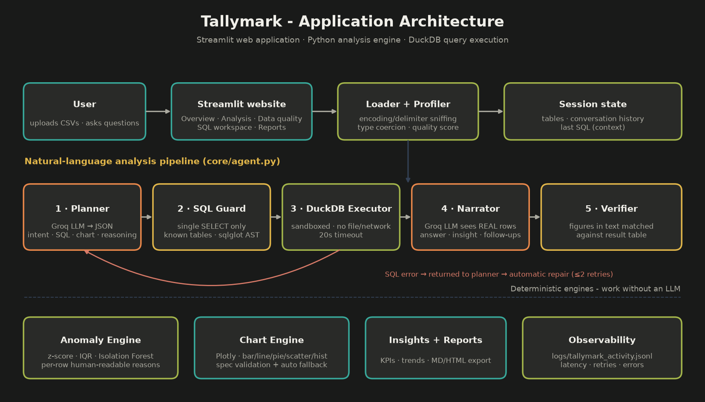
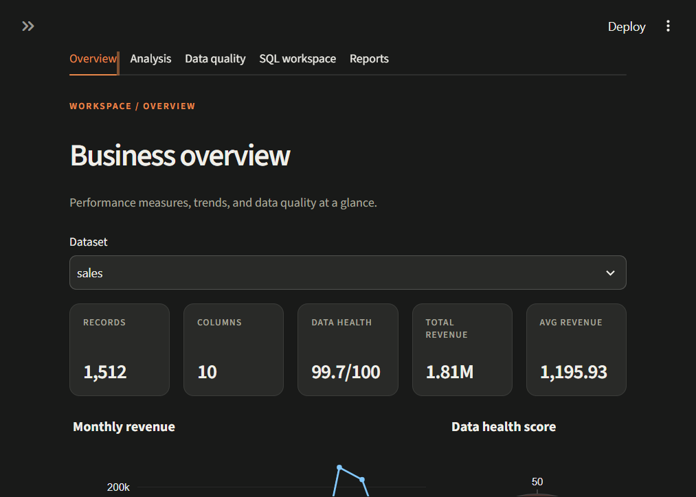
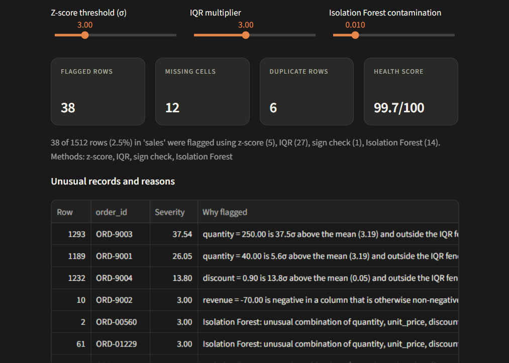

# Tallymark

### CSV analysis, with the numbers to check.

A browser-based workspace for reviewing CSV data, checking trends and investigating unusual records. Natural-language answers include the SQL and result rows used for the calculation.

Built for the *Digital Back Office - AI Engineer Assignment*.

| | |
|---|---|
| **GitHub repository** | [singuharshith/TallyMark](https://github.com/singuharshith/TallyMark) |
| **Demo video** | _Add the 10–30 second recording here or save it as `docs/demo.mp4`_ |
| **Local website** | Run the setup below; no online deployment is required |



The deliverable is a **web application**, as requested in the assignment. Streamlit serves the website and connects its interface directly to the Python analysis modules; a separate frontend or backend service is not required. Deployment is optional when submitting the requested demo video.

## How a question is answered

With a Groq API key configured, the application sends the table schema, question and recent conversation to the model, which proposes a SQL query. `core/sql_guard.py` checks that the query is a single read-only `SELECT` against the loaded tables. DuckDB runs it against the in-memory data with external access disabled and a query timeout; a failed query can be corrected and retried. The model then receives the query results to draft an explanation. The app checks numeric claims against those results and displays the query and rows so they can be reviewed.

The model does not calculate the answer or run generated Python. The SQL result is the source of truth; displayed Pandas code is illustrative.

## Requirement coverage

| Assignment requirement | Where |
|---|---|
| Upload & validate one or more CSVs | `core/loader.py` - encoding + delimiter sniffing, empty/size/type checks, column normalisation, currency/date coercion, per-file error messages |
| Natural-language questions | `core/agent.py` + `core/prompts.py` (optional Groq API key) |
| Business insights & summaries | `core/insights.py` (computed KPIs/facts) + optional AI executive summary |
| Charts (bar, line, pie, scatter, histogram) | `core/charts.py` - spec validation with auto-selection fallback |
| SQL and/or Pandas code | Shown with answers; “Generate SQL for this analysis” reuses the last query; the **SQL workspace** runs user-edited read-only queries |
| Anomaly detection with explanations | `core/anomalies.py` - z-score, IQR, sign check, Isolation Forest; every row has a plain-English `why_flagged` |
| Explain reasoning | reasoning + assumptions + grounding badge in each answer |
| Conversation context | last 4 turns + previous SQL passed to the planner ("now break that down by month") |
| **Bonus** | multi-file joins · data-quality score · dashboard · report export (MD/HTML) · logging/observability · evaluation script · Docker · tests |

## Quick start

### Option A - Python

#### Windows (PowerShell)
```powershell
py -m venv .venv
.\.venv\Scripts\python.exe -m pip install -r requirements.txt
Copy-Item .env.example .env
# Open .env and set GROQ_API_KEY (free at console.groq.com)
.\.venv\Scripts\streamlit.exe run app.py
```

#### macOS / Linux
```bash
python3 -m venv .venv
source .venv/bin/activate
pip install -r requirements.txt
cp .env.example .env
# Edit .env and set GROQ_API_KEY (free at console.groq.com)
streamlit run app.py
```
Open http://localhost:8501 → click **Load sample datasets** → try the suggested questions.

### Option B - Docker
```bash
docker compose up --build
```
Create `.env` from `.env.example` first (PowerShell: `Copy-Item .env.example .env`) and set `GROQ_API_KEY`.

> No API key? Dataset summaries, charts, data-quality checks and anomaly detection still work. A Groq API key is needed for natural-language questions and AI-written summaries.

## Sample data

The bundled sales and customer records are synthetic. Sales amounts are in GBP. The data includes a deliberately reduced March sales volume, missing values, duplicate rows and four planted anomalies so the analysis can be tried without uploading business data. The figures and names do not represent real customers, a company or market.

## Try these questions (sample data)

- Which region generated the highest revenue?
- Show monthly sales trends.
- Which products are underperforming?
- What are the top five customers?  *(joins `sales` with `customers`)*
- Why did revenue drop in March? *(the sample data includes a deliberate drop, concentrated in the East region)*
- Now break that down by product. *(follow-up using context)*
- Generate SQL for this analysis.
- Detect anomalies in the dataset. *(4 planted anomalies: ORD-9001…9004)*

## Project structure
```
app.py                 Tallymark website (Overview · Analysis · Data quality · SQL workspace · Reports)
core/                  UI-independent analysis engine, called by the website
  loader.py profiler.py sql_guard.py executor.py llm.py prompts.py
  agent.py             plan → validate → execute/repair → explain → verify
  anomalies.py charts.py insights.py grounding.py pandas_codegen.py report.py logging_utils.py
ui/                    theme.css + components
tests/                 45 passing tests (loader, SQL guard, executor, anomalies, sample data, agent w/ fake LLM, UI smoke test)
scripts/               generate_sample_data.py · evaluate.py · make_architecture.py
sample_data/           sales.csv, customers.csv
docs/                  architecture.png, screenshots, demo video
```

## Testing & evaluation
```bash
pytest -q                          # unit + pipeline tests (no network needed)
GROQ_API_KEY=... python scripts/evaluate.py   # runs the assignment's example questions with the real LLM
```
Ground truth for the evaluation is computed independently in pandas.

## Security & reliability decisions
- Read-only, single-statement SQL, AST-validated against an allow-list of tables; DuckDB external access disabled.
- API key comes from env or sidebar; never written to disk or logs.
- Friendly errors for bad CSVs, missing key, bad SQL, empty results, LLM outages; unexpected exceptions are logged, not shown.
- Questions and SQL statements are logged locally to `logs/tallymark_activity.jsonl`, alongside intent, attempts and timing. Logs are excluded from Git.

## Assumptions & notes
- Column names are normalised to snake_case so the LLM and SQL stay consistent.
- "Underperforming" = lowest by the main metric; the definition is shown under *Assumptions* for each answer.
- Anomalies use statistical thresholds (default 3σ / 3×IQR / Isolation Forest 1%) adjustable in **Data quality**; a flagged value is a lead to investigate, not proof of an error.
- The Pandas snippet is generated by the LLM for readability and is **not executed**; the SQL is the source of truth.
- With Groq enabled, the table schema, question, recent conversation and query results are sent to Groq for analysis.
- Uploaded data and chat answers are held in the Streamlit session; the application does not persist the CSV contents. Questions and SQL are persisted in the local activity log described above. Avoid using sensitive data.

## Screenshots
Captured with the bundled sample datasets. The data-quality screenshot shows flagged records without an API key.

### Overview


### Data quality

